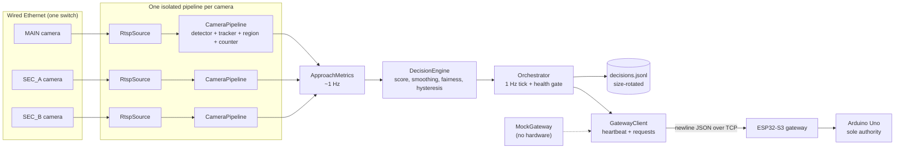

# Intelligent Traffic Control

[](https://www.python.org/)
[](https://opencv.org/)
[](https://www.ultralytics.com/)

The AI host for **Smarti**, a single-intersection traffic controller. Three
cameras watch the approaches over wired Ethernet; the host detects and tracks
vehicles, turns each stream into demand metrics, recommends a green time, and
sends it as an **advisory** request to an ESP32-S3 gateway over Wi-Fi. The
ESP32 and the Arduino Uno remain the authority for signal sequencing.

Nothing in this repository has been validated on hardware. It is verified
against recorded video and the bundled mock gateway only.

## Architecture



Each camera has its own detector, tracker, road region, counter, congestion
window and polygon. This is not an accident of style: Ultralytics'
`persist=True` keeps ByteTrack state on the model object, so a shared detector
would mix track IDs between streams. `tests/test_pipeline_isolation.py` proves
the isolation.

## Safety model

- **Advisory only.** A request is stored by the Uno as *pending* and applied at
  the next phase entry. The host never claims a phase changed.
- **No emergency priority.** `priority` is always `"NORMAL"`; there is no
  emergency code path.
- **Fail safe.** If any approach is unhealthy (camera not `LIVE`, metrics older
  than 2 s, or a stalled pipeline), the engine makes no recommendation and the
  heartbeat gate closes. The gateway then expires the link and the Uno runs its
  autonomous cycle. Missing data is never treated as zero traffic.
- **No flooding.** One request in flight, 2 s reply timeout, 8 s minimum
  interval, and requests only on a material change.
- **Two movements only.** The wire protocol knows `MAIN` and `SECONDARY`.
  `SEC_A` and `SEC_B` both map to `SECONDARY` ("two-phase compat mode"). True
  three-phase control needs new movement names and Uno phase logic, which were
  not invented here.

## Installation

Python 3.10+ on Windows or Linux.

```bash
python -m venv .venv
# Windows: .venv\Scripts\activate
# Linux/macOS: source .venv/bin/activate
pip install -r requirements.txt
```

The first run downloads `yolo11n.pt` through Ultralytics. All tests run on CPU.

## Quick start without hardware

1. Copy the example config and point the cameras at video files:

   ```bash
   cp config.example.yaml config.yaml
   ```

   Replace the three RTSP camera entries with file sources, for example:

   ```yaml
   cameras:
     - id: cam_main
       approach: MAIN
       source: file
       path: samples/main.avi
       loop: true
       realtime: true
       target_fps: 8
   ```

   Any traffic video works; the three files can even be the same clip. Keep the
   `approaches` mapping and `health.required_cameras: 3`.

2. Start the mock gateway in one terminal:

   ```bash
   python -m gateway.mock_gateway
   ```

   It prints `{"mock_gateway": "listening", "host": "127.0.0.1", "port": 3333}`.
   Useful flags: `--nack-rate 0.1`, `--timeout-rate 0.1`, `--seed 3`,
   `--heartbeat-freshness 3.0`.

3. Run the host in another terminal:

   ```bash
   python main.py --config config.yaml --mock-gateway
   ```

   Decisions are appended to `logs/decisions.jsonl`. Add `--display` to see the
   annotated tiles, or `--dry-run` to run without any gateway at all.

## Legacy single-camera demo

The original visual demo still works, without a config file or gateway:

```bash
python main.py --source webcam:0
python main.py --source file:samples/clip.avi
```

It opens the annotated window (IDs, movement, counting line, road region,
counts, congestion) and exits on `q`.

## Running with real cameras and the ESP32

1. Network the cameras and the laptop as described in
   [`docs/NETWORKING.md`](docs/NETWORKING.md): camera subnet `192.168.50.0/24`,
   which must not overlap the ESP32 SoftAP `192.168.4.0/24`. Join the laptop to
   `Smarti-Gateway` over Wi-Fi for the gateway link.
2. Export credentials (never commit them):

   ```bash
   export CAM_USER=admin
   export CAM_PASS=...
   ```

3. Edit `config.yaml`: three RTSP URLs (use each camera's **sub-stream**, 720p,
   H.264, 5–15 fps), per-camera polygon and counting line if needed.
4. Run:

   ```bash
   python main.py --config config.yaml
   ```

5. Verify the link: `logs/decisions.jsonl` should show `"health_gate_open": true`
   and `"accepted": true` requests. If the gate stays closed, the log names the
   unhealthy approach or the missing fresh camera.

## Configuration

`config.example.yaml` is the reference; `config.yaml` is ignored by git.
`${VAR}` placeholders are expanded from the environment, and a missing variable
is a startup error. Relative file paths are resolved against the config file.

| Section | Purpose |
| --- | --- |
| `cameras` | `id`, `approach`, `source` (`rtsp`/`webcam`/`file`), `url`/`index`/`path`, `flip`, `target_fps`, normalized `polygon`, normalized `count_line`, `width`/`height`, `stale_after_s`. |
| `approaches` | Approach id → wire movement (`MAIN` or `SECONDARY`). One camera per approach. |
| `phase_mode` | Only `two_phase_compat` is accepted. |
| `decision` | Weights, `base_green_s`, `k_green_s`, `score_saturation`, green min/max (inside the protocol's 5–30), `min_delta_s`, `min_interval_s`, starvation and smoothing windows, health policy, `aggregation: sum|max`. |
| `gateway` | Host, port, connect/handshake/request timeouts, heartbeat interval, reconnect bounds, request backoff. |
| `health` | Frame freshness, tick interval, tick timeout, `required_cameras` (`null` = all). |
| `detection` | Model path, `device: auto|cuda|cpu`, confidence, optional `imgsz`. |
| `logging` | Console level, JSONL path, rotation size and backup count. |
| `display` | Default for the annotated window. |

### Decision parameters

```text
score = w_queue * vehicles_in_region
      + w_stationary * stationary_count
      + w_wait * max_wait_s
      + w_congestion * congestion_weight     # Low 0, Moderate 1, High 2
green = clamp(round(base + k * min(1, score / score_saturation)), 5, 30)
```

Metrics are smoothed over `smoothing_window_s`; a group that has waited more
than `max_wait_before_force_s` with demand is forced to the top. All weights and
thresholds are **starting values to be tuned on real footage**, not calibrated
constants. See [`docs/DECISION.md`](docs/DECISION.md) for the full policy and
the reasoning behind the health choice.

## Gateway protocol

UTF-8 JSON, one compact object per line (`\n`), maximum 512 bytes per line. The
reader buffers until newline and survives split or merged TCP chunks; oversized
lines are discarded to the next newline.

| Direction | Message | Reply |
| --- | --- | --- |
| Host → gateway | `{"type":"HEARTBEAT"}` | `{"type":"GATEWAY_ACK","status":"HEARTBEAT_OK"}` |
| Host → gateway | `{"type":"STATUS_REQUEST"}` | `{"type":"UNO_STATUS","detail":"STATUS:..."}` |
| Host → gateway | `{"type":"TRAFFIC_REQUEST","movement":"SECONDARY","green_time":15,"priority":"NORMAL","sequence":104}` | `{"type":"GATEWAY_ACK","status":"CONTROLLER_ACCEPTED","sequence":104,"uno_ack":"ACK:REQUEST_SIDE,15"}` |

Rejections are `{"type":"ERROR","reason":"..."}` with `AI_LINK_OFFLINE`,
`INVALID_FIELDS`, `OUT_OF_POLICY`, `STALE_SEQUENCE`, `UNO_ACK_TIMEOUT` or
`UNO_NACK`. A new TCP session starts without a valid heartbeat and with the
sequence reset; the client handshakes with a heartbeat, then starts at 1.
Heartbeats are sent every second only while the decision loop has ticked within
2 s and the required cameras are fresh; a traffic request does not refresh
freshness.

## Decision log

One JSON object per tick in `logs/decisions.jsonl`, rotated by size:

- `ts`, `monotonic_s`
- `health_gate_open`
- `cameras`: state, fps, frame age, reconnect count
- `approaches`: the full `ApproachMetrics` snapshot (counts, stationary,
  crossings, congestion, mean/max wait, frame age, latency)
- `decision`: healthy, emitted, group scores, human-readable reasons
- `recommendation`: movement, green time, priority, reasons, scores
- `request`: sent flag, movement, green time, sequence, accepted, status,
  latency, raw gateway reply

Cycles that emit nothing are logged too, which is what makes comparison with a
fixed-time baseline possible later.

## Tests

```bash
pytest
```

No GPU, camera, or network is required. Coverage includes framing edge cases
and field validation, handshake/reconnect/sequence reset, heartbeat gating,
every gateway error reply, camera manager lifecycle and stale detection,
per-camera pipeline isolation, decision rules (smoothing, starvation,
hysteresis, clamping, degraded cameras), config validation, log rotation, and an
end-to-end run of three looping videos through decisions to the mock gateway.

## Project structure

```text
Intelligent_Traffic_Control/
├── app/
│   ├── config.py           # typed YAML config + source factory
│   ├── decision_log.py     # size-rotated JSONL
│   └── orchestrator.py     # 1 Hz tick, health gate, display
├── analytics/
│   ├── congestion.py       # Low/Moderate/High window analysis
│   ├── road_region.py      # polygon filtering
│   └── vehicle_counter.py  # normalized-line counting with timestamps
├── camera/
│   ├── base.py             # FrameSource, latest-frame capture threads
│   ├── file_source.py      # looping video for development
│   ├── manager.py          # lifecycle + health aggregation
│   ├── rtsp.py             # TCP-transport IP cameras
│   └── webcam.py           # USB/built-in camera
├── decision/
│   ├── engine.py           # scoring, fairness, hysteresis
│   ├── models.py           # ApproachMetrics, Recommendation
│   └── settings.py         # tunable parameters
├── detection/
│   ├── object_classifier.py
│   └── vehicle_detector.py # YOLO + ByteTrack, one per camera
├── gateway/
│   ├── client.py           # threaded reconnecting client
│   ├── mock_gateway.py     # hardware-free gateway
│   └── protocol.py         # framing + validation
├── pipeline/
│   └── camera_pipeline.py  # per-camera perception worker
├── tests/
├── docs/
├── config.example.yaml
├── main.py
└── requirements.txt
```

## Limitations

- **Not validated on hardware.** Cameras, RTSP paths, the ESP32 and the Uno have
  not been tested. URL paths differ by vendor; the example is a placeholder.
- **Three-phase control is not implemented.** The protocol has only `MAIN` and
  `SECONDARY`; `SEC_A`/`SEC_B` share `SECONDARY` in compat mode. Real
  three-phase control requires firmware and protocol changes.
- Decision weights, green-time parameters and congestion thresholds are
  heuristics and are untuned.
- Accuracy depends on lighting, camera angle, occlusion and shadows.
- There is no license file and no CI configuration.
